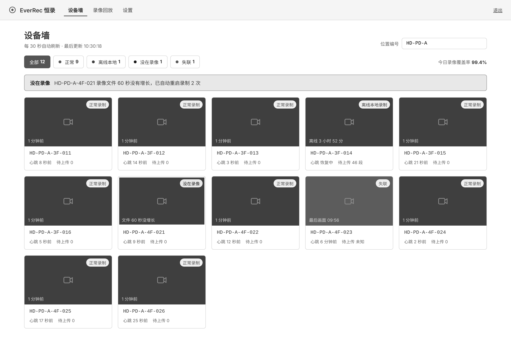
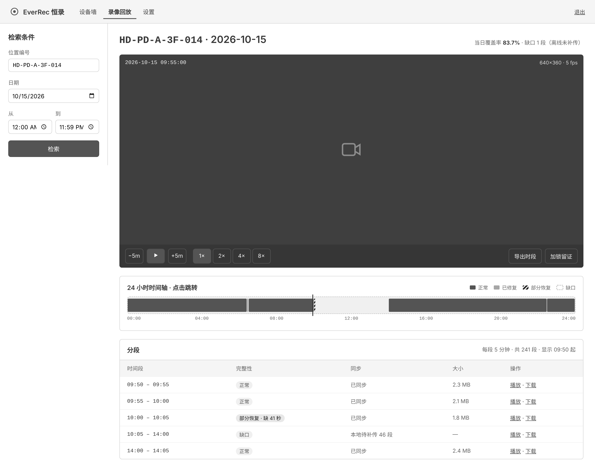
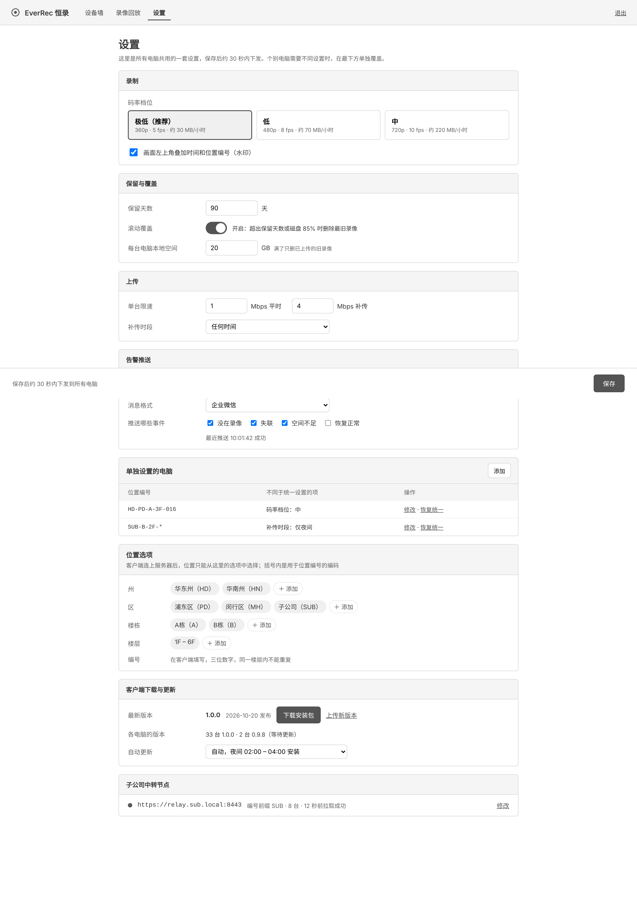
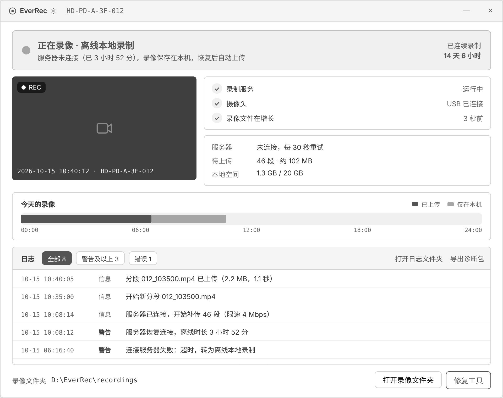
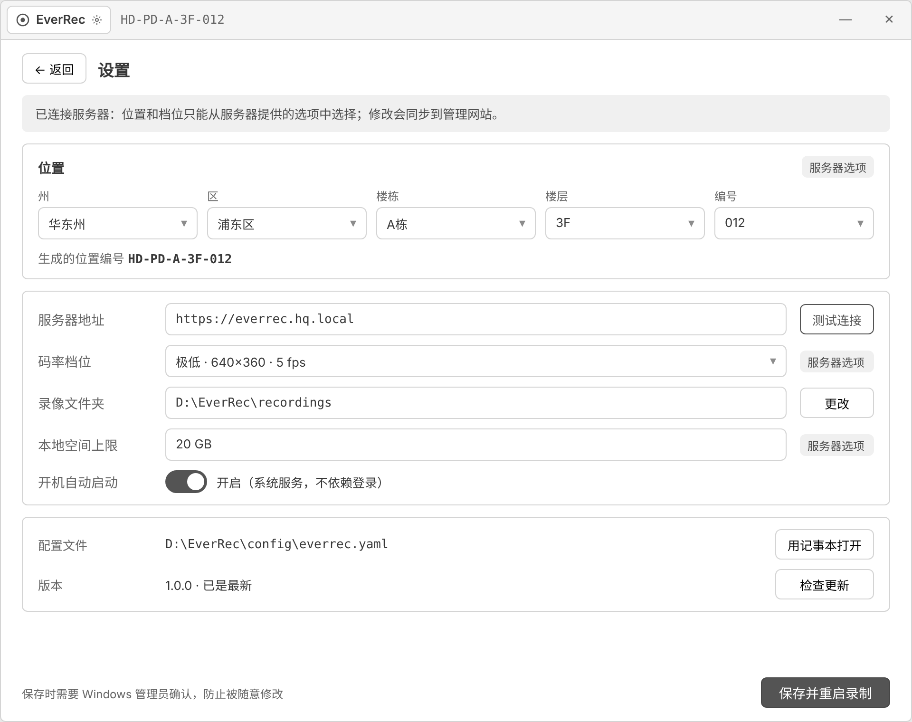
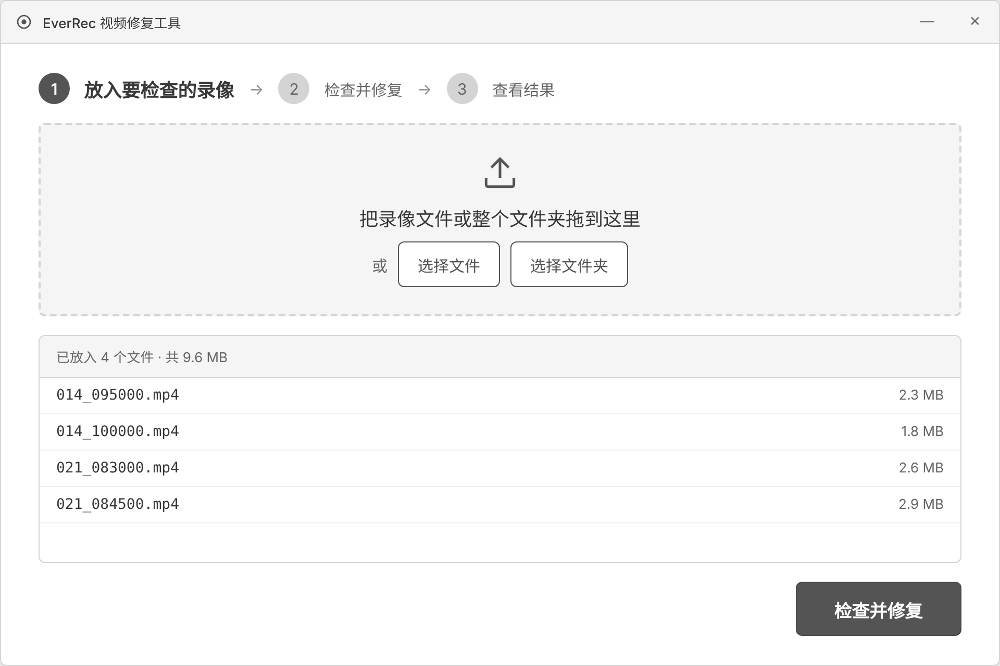
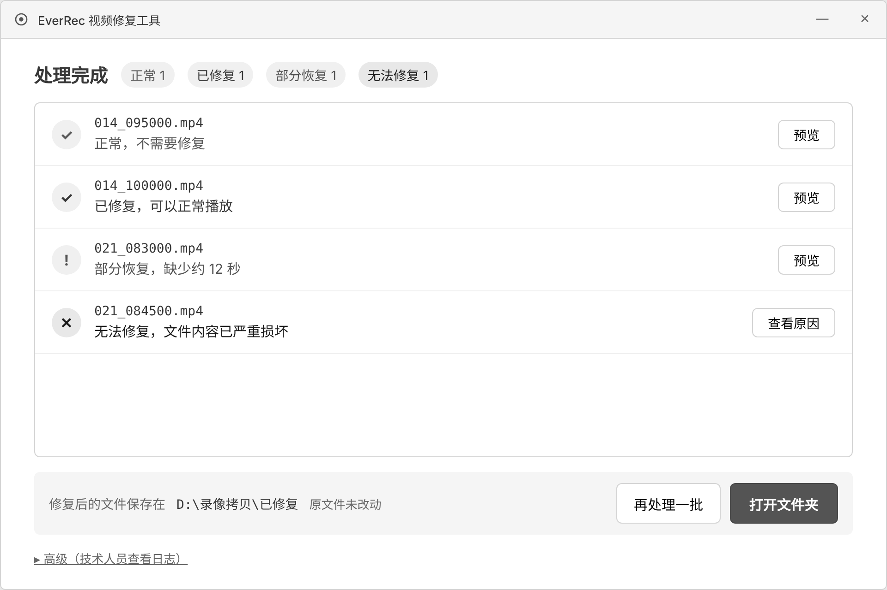
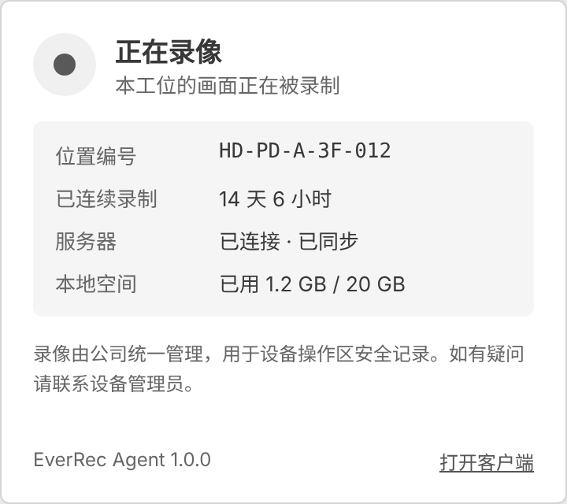

# EverRec（恒录）

面向设备操作区的轻量录像系统：每台操作区电脑 24 小时连续录制，能连上服务器就集中管理，连不上就在本地独立运行；管理网站统一查看每个摄像头是否在正常录制。

**状态：可运行的骨架（v0.1）。** 已打通“录制 → 健康检查 → 心跳 → 失联判定 → 设备墙”这条主线；上传、回放、设置页、桌面端窗口尚未实现，见下方[骨架进度](#骨架进度)。

## 核心特点

- **录像不断**：开机自启的系统服务，分段录制，断电只损失最后几秒；网络中断时录在本机，恢复后自动补传。
- **一眼看出谁没在录**：不只看进程是否在运行，还检查录像文件是否持续增长，卡住没录能在 60 秒内发现。
- **很省空间**：默认每路约 30 MB/小时，35 台 24 小时录制每天约 25 GB，默认保留 90 天并滚动覆盖。
- **不强依赖服务器**：客户端可完全本地配置运行；子公司网络单向隔离时，用中转节点由主服务器主动拉取状态。
- **普通人也能修录像**：桌面修复工具拖入文件、一键检查修复，原文件不动。

## 文档

- [开发手册](AGENTS.md)：给接手开发的人和 agent，包括规矩、实测踩过的坑、Windows 验证方式。
- [剩余工作包](docs/tasks.md)：第一版剩下的工作，拆成可并行的独立任务，各有接口约定和验收标准。
- [设计文档 V0.3（精简版）](docs/design.md)：需求、架构、采集端、存储与上传、状态监控、推送与 API、视频修复、数据模型、容量规划、部署与分期计划。

## 界面设计稿

管理网站 3 页，桌面端 3 个窗口，配色为黑白灰。可交互的网页版在 [`design/html`](design/html)：下载仓库后用浏览器打开 `design/html/index.html` 即可，页面上的按钮和筛选能点击，数据均为示例。

### 管理网站

| 设备墙 | 录像回放 |
| --- | --- |
|  |  |

| 设置 |
| --- |
|  |

### 桌面端

| 录像客户端 | 离线时 | 设置（点左上角图标进入） |
| --- | --- | --- |
|  |  |  |

| 修复工具 | 修复结果 | 托盘状态窗 |
| --- | --- | --- |
|  |  |  |

## 目录结构

```
packages/
  core/      everrec-core    公共核心库：配置、FFmpeg 录制命令、分段归档、健康检查、1/2 级修复、心跳格式
  agent/     everrec-agent   采集端：录制、断线照常录、启动时修复中断分段、本地滚动覆盖、心跳
  server/    everrec-server  服务端：心跳接口、失联判定、事件表、GET /api/v1/devices
web/                         管理网站（React + TypeScript + Vite），目前只有设备墙
config/everrec.example.yaml  客户端配置示例
deploy/                      WinSW 服务定义（Windows Agent）、systemd 单元（Linux 服务端）
docs/                        设计文档与架构图
design/                      界面设计稿（源文件、网页版、截图）
```

## 本地跑起来

需要 Python 3.12、[uv](https://docs.astral.sh/uv/)、FFmpeg（带 libx264）、Node 20+。

```bash
uv sync                                   # 安装 Python 依赖
uv run pytest                             # 跑测试（会用 FFmpeg 测试画面真录几秒）

cd web && npm install && npm run build && cd ..
EVERREC_WEB_DIST=web/dist uv run everrec-server --port 8080   # 浏览器打开 http://127.0.0.1:8080

# 另开一个终端：起一台模拟录制点（camera.type 改成 test 就不需要真摄像头）
uv run everrec-agent init ./demo
#   编辑 ./demo/config/everrec.yaml：server 填 http://127.0.0.1:8080，camera.type 填 test
uv run everrec-agent run -c ./demo/config/everrec.yaml
```

开发管理网站时用 `cd web && npm run dev`，`/api` 会自动转发到 8080。

## 骨架进度

| 部分 | 已有 | 下一步 |
| --- | --- | --- |
| 录制 | FFmpeg 分段录 MPEG-TS、错峰切段、档位、水印、进程崩溃退避重启、单实例 | 在真实 USB 摄像头和 Windows 上验证；分段转 MP4 供网页播放 |
| 健康检查 | ①③④⑥，④ 判“文件是否在长”，30 秒不长自动重启；② 从 FFmpeg 报错识别 | 缩略图 |
| 离线自治 | 连不上服务器照常录，记录离线时段，恢复后设备墙显示黄色 | 上传与补传（错峰、限速、名额、断点续传） |
| 修复 | 1 级重新封装、2 级截断恢复；启动时自动处理中断分段，原文件进隔离目录 | 桌面修复工具窗口 |
| 服务端 | 心跳、失联判定（大批失联合并）、状态变化写事件表、设备列表接口 | 录像接收与索引、推送投递、管理员密码、Agent 凭据、中转节点 |
| 管理网站 | 设备墙：状态筛选、编号前缀筛选、异常提示条、设备日志 | 录像回放、设置 |
| 桌面端 | — | 客户端窗口、托盘（PySide6） |
## 规划的技术选型

Python 3.12 + FFmpeg（采集端与修复）、FastAPI + PostgreSQL（服务端，Linux）、React + TypeScript（管理网站）、PySide6（桌面端）。详见设计文档第 12 节。
