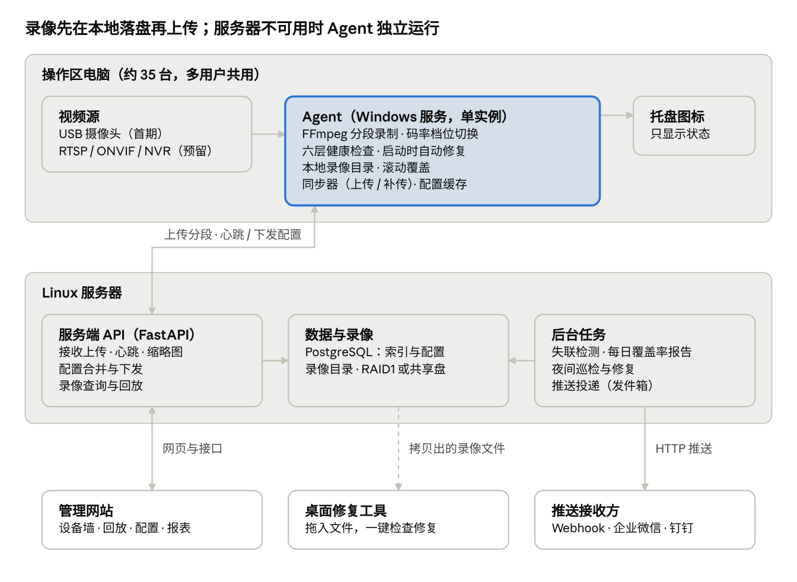
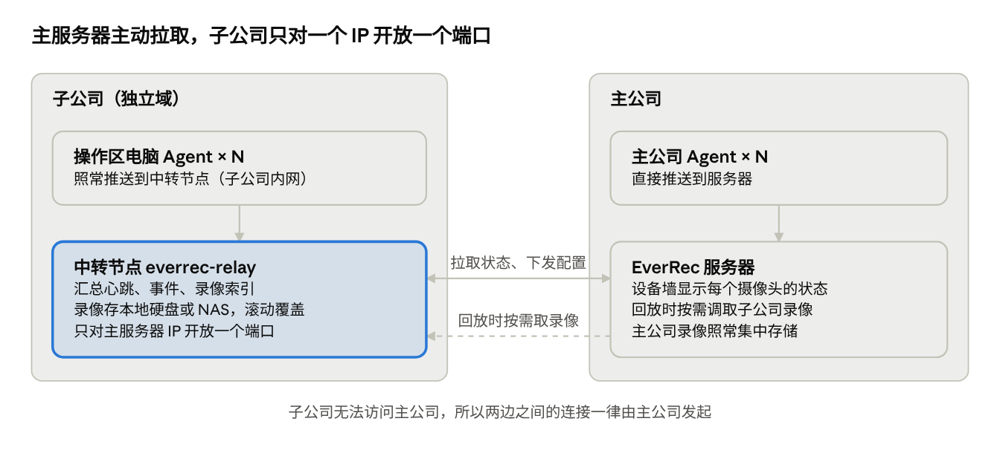

# EverRec（恒录）录像管理系统 设计文档 V0.3（精简版）

版本日期：2026-10-15

## 1. 概述

本系统为设备操作区提供 24 小时连续录像：每个录制点在本地录制，能连上服务器就集中存储，连不上就独立在本地运行，并由管理网站统一配置和监控。系统名为 EverRec（恒录），是独立项目，自行开发，不依赖 Titanloom。服务端部署在 Linux 服务器上，操作区电脑仍为 Windows。

**目标**

- 约 35 个录制点，24 小时连续录制，每路约 30 MB/小时
- 录制点可以离线自治：服务器不可用时继续录制，恢复后自动补传
- 管理人员能随时看到每个录制点是否在正常录制，异常时主动推送告警
- 录像损坏时，非技术人员也能用桌面工具自行修复

**范围内**

- 采集端 Agent、服务端、管理网站、桌面修复工具、安装脚本
- USB 摄像头（首期）和网络摄像头（RTSP / ONVIF，接口预留）
- 区域层级配置、事件推送（Webhook）

**不做**

- 智能分析（人员识别、行为识别等）
- 录音
- 云端存储和公网访问

**术语**

| 术语 | 含义 |
| --- | --- |
| 录制点 | 区域层级中最末一级，对应一个摄像头的拍摄位置 |
| Agent | 安装在操作区电脑上的录制服务 |
| 分段 | 按固定时长切分的一个录像文件，默认 1 小时（可在管理网站改成 5 / 10 / 15 / 30 分钟） |
| 档位 | 一组预设的分辨率、帧率和码率上限 |
| 离线模式 | Agent 连不上服务器时，录像只存本地的运行状态 |
| 滚动覆盖 | 空间或时长超出限制时，自动删除最旧的录像 |

**组件命名**：everrec-agent（采集端）、everrec-server（服务端）、everrec-web（管理网站）、everrec-repair（桌面修复工具）。

### 1.1 精简原则（V0.3）

软件要轻：管理网站只有 3 页，桌面端只有 3 个窗口；客户端不做登录，只记录位置编号。凡是第一版用不上的功能都后移或去掉，本节是范围的最终依据，后文标"第二期"的内容不进第一版。

| 部分 | 第一版 | 第二期 | 不做 |
| --- | --- | --- | --- |
| 客户端 | USB 录制、1 小时分段（可改 5 / 10 / 15 / 30 分钟）、**屏幕录制（Windows 桌面，与摄像头二选一）**、**一键截屏**、**定时截屏（本地保存，带开关）**、开机自启、离线本地录制、本地滚动覆盖、文件增长检查、启动时自动修复、托盘图标、客户端窗口（主界面含日志，左上角图标进入设置）、本地配置文件、从网站下载和自动更新、时间与编号水印 | 网络摄像头、黑屏冻结检测、自动降档、同一台电脑同时录摄像头和屏幕 | 登录、管理员模式、记录登录用户、自定义码率、H.265、硬件编码选项、隐私遮挡、移动侦测、预录、多摄像头 |
| 存储与上传 | 上传到服务器（子公司经中转节点）、错峰、限速、断点续传、保留天数与滚动覆盖开关 | 共享文件夹存储 | — |
| 管理网站 | 设备墙、录像回放、设置（全局一套，个别电脑单独覆盖）；一个管理员密码 | 区域树与逐级继承、Excel 导入、每日报告、修复中心、远程升级 | 多角色、按区域授权 |
| 推送与 API | 一个推送地址（企业微信 / 钉钉 / 通用 JSON）、4 类事件 | 合并与时段规则、自定义模板、完整开放 API | — |
| 修复工具 | 拖入、修复、看结果（第 1、2 级修复） | 第 3、4 级修复、索引修复 | — |

## 2. 需求汇总

需求共 12 条功能需求和 7 条非功能需求，编号供后续设计和验收引用。

**功能需求**

| 编号 | 需求 | 说明 |
| --- | --- | --- |
| F01 | 24 小时连续录制 | 按分段写文件，异常中断后自动恢复 |
| F02 | 多类型摄像头 | 首期 USB，网络摄像头（RTSP / ONVIF / NVR 通道）接口预留 |
| F03 | 一台电脑只录一份 | 多用户共用电脑时，录制与登录用户无关，全机单实例 |
| F04 | 码率可切换 | 默认每小时约 30 MB，可手动或按规则自动切换档位 |
| F05 | 存储位置可配置 | 服务器、共享文件夹或本地；同一时刻只写一处 |
| F06 | 离线自治 | 连不上服务器时在本地独立运行，恢复后补传 |
| F07 | 滚动覆盖 | 本地和服务器两侧按配额或天数删除最旧录像 |
| F08 | 录制状态监控 | 判断是否已开始、是否正常录制，识别假录制、黑屏、冻结 |
| F09 | 区域层级配置 | 用位置编号标识每台电脑；全局一套参数，个别电脑单独覆盖（区域层级继承为第二期） |
| F10 | 管理网站 | 设备墙、录像回放、设置，共 3 页 |
| F11 | 事件推送与开放 API | 推送到任意 HTTP 地址（Webhook）；提供开放 API 供其他系统查询和控制 |
| F12 | 视频修复 | 自动修复加桌面工具，面向非技术人员 |

**非功能需求**

| 编号 | 需求 | 指标 |
| --- | --- | --- |
| N01 | 规模 | 约 35 个录制点，可扩展到 50 个以上 |
| N02 | 录像完整性 | 断电最多损失最后几秒；网络中断不丢录像 |
| N03 | 状态及时性 | 设备失联 2 分钟内发现；假录制 30–60 秒内发现 |
| N04 | 资源占用 | 采集端 CPU 和内存占用低，不影响操作区电脑的正常使用 |
| N05 | 服务器平台 | Linux 服务器；操作区电脑为 Windows |
| N06 | 易用性 | 修复工具无需技术知识即可使用 |
| N07 | 可运维性 | 批量安装、自动注册、集中配置、远程升级 |

## 3. 总体架构

系统由四部分组成：操作区电脑上的 Agent、Linux 服务器上的服务端、管理网站和桌面修复工具；录像总是先写本地，再由 Agent 上传。



Agent 是唯一接触摄像头的组件，服务器不可用时它按缓存配置继续录制；失联检测、报表、修复巡检和推送都在服务器后台任务中完成。桌面修复工具可脱离服务器单独使用。

### 3.1 子公司部署：中转节点与拉取模式

子公司属于另一个域，主公司能访问子公司，子公司不能访问主公司。因此子公司内放一台中转节点，录像留在子公司，主服务器主动拉取每个摄像头的状态，需要回放时再按需取录像。



| 项目 | 设计 |
| --- | --- |
| 子公司 Agent | 不改代码，只把服务器地址配成中转节点 |
| 中转节点 | everrec-relay，部署在子公司内网的一台 Linux 小主机或虚拟机；接收 Agent 的心跳、事件和录像，录像存本地硬盘或子公司 NAS，按保留天数滚动覆盖 |
| 拉取内容 | 主服务器每 30 秒拉取一次：每个摄像头的状态和六层检查结果、新事件、新增录像的索引、缩略图；同一次请求带上配置变更 |
| 回放 | 管理网站请求子公司的录像时，主服务器向中转节点取对应分段并短期缓存；录像不长期搬到主公司 |
| 失联判定 | 中转节点负责判定子公司各设备是否失联；主服务器连续 3 次拉不到中转节点时，告警"子公司中转节点失联"，不把各设备逐台报失联 |
| 网络要求 | 子公司防火墙只对主服务器的 IP 放行中转节点的一个 HTTPS 端口 |
| 认证 | 主服务器与中转节点之间用独立密钥和 HTTPS，不依赖任一方的域账号 |

延迟代价：子公司设备的状态在设备墙上最多晚一个拉取周期（约 30 秒）。以后如果还有其他网络隔离的厂区，照此各放一台中转节点。

Dify、RPA 不作为数据通道；如需通知它们，用第 8 节的 Webhook 推送。

## 4. 采集端 Agent

Agent 以系统服务方式常驻在每台操作区电脑上，开机即录，与登录的用户无关；一个 Agent 可以接多路摄像头。

### 4.1 运行方式与单实例

- Windows 上注册为 Windows Service（开机自启、不依赖登录）；Linux 上用 systemd。
- 用系统级互斥锁（`Global\` 命名的 Mutex）保证整台机器只有一个录制进程，用户登录、注销、切换都不影响录制。
- 客户端不做登录，每段录像只记录位置编号。客户端只有一个主界面（录制状态、今天的录像、日志），点左上角图标进入设置；设置的取值规则见 4.6。
- 托盘图标对所有登录用户可见，只显示状态，不提供停止录制的操作。

**已知限制**：USB 摄像头同一时间只能被一个程序打开，服务占用后用户无法再用它开视频会议。Windows 10/11 的"允许桌面应用访问相机"必须开启，由安装脚本统一配置并纳入健康检查。

### 4.2 视频源抽象

第一版只做 USB 摄像头；接口按下表预留，网络摄像头放第二期。录制、分段、上传、监控逻辑共用，下面按类型接入不同实现：

| 类型 | 接入方式 | 编码 | 首期 |
| --- | --- | --- | --- |
| USB 摄像头 | Windows dshow / Linux v4l2，按设备名加 VID/PID 识别 | Agent 编码 | 是 |
| 屏幕（Windows 桌面） | FFmpeg `gdigrab` 抓主屏 | Agent 编码 | 是（与摄像头二选一） |
| 网络摄像头 | RTSP 拉流 | 直接录制或转码 | 接口预留 |
| ONVIF 摄像头 | 自动发现后取 RTSP 地址，可远程设码率 | 直接录制或转码 | 接口预留 |
| NVR 通道 | RTSP（按通道号） | 直接录制或转码 | 接口预留 |
| HTTP / MJPEG | HTTP 拉流 | Agent 编码 | 按需 |

- 网络摄像头不必插在电脑上，可以分配给附近任意 Agent，也可以由服务器上的 Agent 录制。
- 网络摄像头优先使用子码流直接录制；子码流达不到目标码率（很多最低 128–256 kbps）时由 Agent 转码。
- 添加摄像头时自动探测分辨率、编码和帧率，给出建议录制方式。
- **屏幕源的限制**：Windows 服务跑在 Session 0，抓不到登录用户的桌面，所以录屏必须有一个跑在用户会话里的进程
  （由登录启动项拉起，写同一份分段目录，归档、上传、健康检查仍由服务负责）。
  因此录屏只在**登录且解锁**期间有效；锁屏、注销、无人登录都没画面，锁屏要单独上报状态，不能算成录制异常。
  录屏和摄像头二选一；同一台同时录两路放第二期（`recording.source` 字段已预留）。

### 4.3 分段录制

- 录制引擎为 FFmpeg，默认 1 小时一段（可配置，挡位 5 / 10 / 15 / 30 / 60 分钟）。
  分段越长文件越少、索引越轻；代价是最新一段要录完才归档上传，所以回放最新画面最晚晚一个分段时长，
  断电最多损失正在录的那一段。
- 录制格式用抗损坏的 fMP4 或 MPEG-TS，断电只损失最后几秒；分段结束后可转为普通 MP4 便于网页播放。
- 录制进程异常退出自动重启，重启次数计入健康状态。

### 4.4 码率档位

| 档位 | 分辨率 / 帧率 | 码率上限 | 每小时约 |
| --- | --- | --- | --- |
| 极低（默认） | 640×360 / 5 fps | 64 kbps | 30 MB |
| 低 | 480p / 8 fps | 150 kbps | 70 MB |
| 中 | 720p / 10 fps | 500 kbps | 220 MB |

编码参数：H.264，`-preset veryfast`，CRF 加码率上限（`-crf 30 -maxrate 64k -bufsize 128k`），关键帧间隔 10 秒，不录音频。画面静止时实际码率远低于上限。H.265 可再省 30–40%，但浏览器兼容性差，作为可选项。

**切换方式**

- 只能在管理网站切换：全局统一设置，或对单台电脑单独覆盖。
- 不开放自定义码率；自动降档放第二期。
- 切换发生在分段边界，不中断录制、不产生损坏文件。

### 4.5 离线自治

- Agent 在本地缓存最后一次收到的配置（档位、路径模板、配额等），连不上服务器时照常按缓存配置录制。
- 首次部署时即使服务器尚未就绪，也按安装包中的默认配置开始录制。
- 服务器恢复后依次：补传录像、补报离线期间的事件、拉取最新配置。
- 启动时检查上次异常中断的分段，先修复再上传（见第 9 节）。

### 4.6 本地配置与服务器的关系

客户端能完全独立在本地配置和运行；服务器可以介入，但不是必需的。配置按下面的规则取值：

| 情况 | 位置（州、区、楼栋、楼层） | 档位、本地空间等参数 | 怎么改 |
| --- | --- | --- | --- |
| 已连接服务器 | 只能从服务器的"位置选项"中选择，编号在客户端填写 | 用服务器的统一设置或单独覆盖 | 客户端设置里选；或在管理网站改 |
| 未连接服务器 | 自由填写 | 用安装包自带的服务器默认配置 | 客户端设置里改，或直接编辑配置文件增改 |
| 重新连上服务器 | 本地填写的值与服务器选项比对，不在选项里的标红，请管理员在网站上确认或添加选项 | 改为服务器的值，本地值保留在配置文件中作为备份 | — |

- 录像文件夹、服务器地址、开机自启、定时截屏（开关与间隔）始终是本地设置，服务器不覆盖。
- 客户端不做登录；保存本地设置和修改配置文件都需要 Windows 管理员权限（配置文件只有管理员可写），防止被随意改动。
- 保存后在下一个分段边界生效，不中断录制。

配置文件位于安装文件夹，例如 `D:\EverRec\config\everrec.yaml`：

```yaml
server: https://everrec.hq.local      # 子公司填中转节点地址；留空则纯本地运行
location:
  dept: FIN        # 部门
  section: AP      # 科室
  area: E          # 区域
  site: HQ         # 属地
  spot: F3         # 位置
  number: "012"    # 编号
# 位置编号自动生成（空的层级跳过）：FIN-AP-E-HQ-F3-012
# 层级、责任人继承见 docs/org-tree-plan.md（旧的 州/区/楼栋/楼层 配置仍可读）
recording:
  profile: xlow    # xlow / low / mid
  folder: D:\EverRec\recordings
  local_quota_gb: 20
  watermark: true
autostart: true
```

### 4.7 日志

- 日志存在安装文件夹的 `logs` 目录，按天一个文件，保留 30 天。
- 客户端主界面下方的日志区按级别（全部 / 警告及以上 / 错误）查看最近日志，可打开日志文件夹、一键导出诊断包（日志加配置）。
- 连上服务器后，Agent 随心跳上报最近的警告和错误；管理网站在设备墙上点开某台设备即可查看。

## 5. 存储与滚动覆盖

录像总是先落到本地分段，再决定去向；每台设备同一时刻只写一个目标位置，网络中断不丢录像。

### 5.1 存储决策

每个分段结束时：

1. 目标存储（服务器或共享文件夹）可达 → 上传该分段，校验哈希成功后删除本地文件。
2. 不可达 → 保留在本地录像目录，标记"待同步"，进入离线模式。
3. 后台同步线程定时重试，恢复后按时间顺序补传。

### 5.2 存储类型

| 类型 | 方式 | 适用场景 |
| --- | --- | --- |
| 服务器 | HTTP 分片上传到服务端接收接口 | 默认方式，集中管理 |
| 共享文件夹 | SMB（Windows 共享）或 NFS | 已有 NAS 或共享盘 |
| 本地 | 直接写本机磁盘 | 未部署服务器或离线兜底 |

第一版只做上传到服务器（子公司为中转节点），共享文件夹放第二期。三种存储实现同一个接口：写入、存在检查、删除、列举、剩余空间、健康检查。共享文件夹的账号密码加密保存。子公司的录像存在其中转节点上，不搬到主公司（见 3.1）。

### 5.3 路径模板

```
{位置编号}/{yyyy}/{MM}/{dd}/{位置编号}_{HHmmss}.mp4
```

- 位置编号本身表达层级，例如 `HD-PD-A-3F-012`，只用英文、数字和连字符，避免共享盘和跨系统拷贝时的编码问题。
- 客户端本地录像默认放在安装文件夹内的 `recordings`，安装程序默认装到数据盘（如 `D:\EverRec`），没有 D 盘时才装到 C 盘并自动调小配额；卸载和升级时保留录像。
- 每段录像的实际路径写入索引；之后修改编号只影响新录像，旧录像按原路径访问。

### 5.4 滚动覆盖

| 位置 | 规则 | 默认值 |
| --- | --- | --- |
| 本地 | 录像目录超过配额或磁盘使用率超过阈值时删最旧分段；未同步的分段最后删 | 20 GB 或 85% |
| 服务器 | 按设备保留天数或容量配额删最旧分段 | 90 天（可自定义），磁盘 85%；滚动覆盖开关默认开启 |
| 例外 | 网站上"加锁"的录像不参与覆盖（事故留证） | — |

清理以分段为单位，每个分段结束时检查一次；每次清理写入日志。

**保留天数与滚动覆盖开关**：保留天数可按区域自定义（默认 90 天），滚动覆盖设开关（默认开启），二者都可在区域树上继承和覆盖。关闭滚动覆盖后，服务器不再自动删除录像；磁盘达到 85% 时告警，达到 95% 时暂停接收上传，录像继续留在各电脑本地，不会停止录制。本地配额保护始终开启，但只删除已同步到服务器的分段。

### 5.5 上传流量控制

平时的上传量很小，真正的风险是两种"扎堆"：所有设备在同一时刻切段并上传，以及断网恢复后所有设备同时补传积压。设计目标是把上传摊平、补传排队，不让录像上传挤占操作区网络。

**流量估算（35 台）**

| 场景 | 数据量 | 不控制时 | 控制后 |
| --- | --- | --- | --- |
| 日常上传 | 每段 5 分钟约 2.5 MB，35 台每 5 分钟约 88 MB | 同时切段时，几秒内占满百兆链路 | 错峰后平均约 2.3 Mbps |
| 断网 1 天后补传 | 35 台积压约 25 GB | 全部同时补传，百兆链路被占满约半小时以上 | 限 5 台并发、每台 4 Mbps，总计约 20 Mbps，约 3 小时补完 |
| 服务器重启 | 35 台同时重连 | 瞬间大量连接和重试 | 随机退避，几分钟内平滑恢复 |

**措施**

1. **错峰切段与上传**：每台设备按设备编号计算一个固定偏移（0–300 秒），分段边界和上传时刻都错开，避免整点和整 5 分钟同时上传。
2. **实时与补传分两条通道**：刚录完的分段走实时通道，量小，始终允许；积压分段走补传通道，优先级低，按时间从旧到新补。
3. **服务器发放补传名额**：Agent 补传前先向服务器申请名额，服务器同一时刻只放行 N 台（默认 5）；没拿到名额的返回 429 和等待时间，Agent 排队重试。
4. **单台限速**：Agent 上传设带宽上限，默认实时 1 Mbps、补传 4 Mbps，可按区域在网站上调整。
5. **时段策略（可选）**：补传可限定在夜间或指定时段进行，白天只传实时分段。
6. **分片续传**：按 1 MB 分片上传，中断后从断点继续，不重复传已完成的部分；整段完成后校验哈希。
7. **重连退避**：连接失败后按指数退避加随机抖动重试（例如 5 秒、10 秒、20 秒……上限 5 分钟），避免服务器恢复瞬间被同时请求冲垮。
8. **小数据单独走**：心跳和缩略图很小，不受补传排队影响，保证设备状态始终及时。

**可配置参数**：补传并发名额、单台实时与补传限速、补传时段、分片大小、错峰窗口。网站上显示当前上传速率、排队设备数和预计补完时间。

**网络侧建议**：如果条件允许，把录像上传放到独立 VLAN，或在交换机上给录像流量设较低优先级（QoS），确保操作区业务优先。

## 6. 录制状态监控

"进程在运行"不等于"录像正常"，所以分层检查，并由服务器独立判断设备是否失联。第一版做 ①②③④⑥，其中 ④"文件是否增长"用来发现卡住没录；⑤画面检测放第二期。

### 6.1 六层健康检查（Agent 侧）

| 层级 | 检查内容 | 异常情况 | 处理 |
| --- | --- | --- | --- |
| ① 服务 | 录制服务是否运行 | 进程不存在 | 服务管理器自动拉起 |
| ② 设备 | 摄像头是否存在、能否打开；RTSP 能否连上 | 拔出、被占用、权限被关、认证失败 | 重试并上报 |
| ③ 录制进程 | FFmpeg 是否运行 | 异常退出 | 自动重启，累计次数 |
| ④ 数据流 | 当前分段文件是否持续增长，帧数和时间戳是否推进 | 30 秒无增长（假录制） | 重启录制并告警 |
| ⑤ 画面 | 定期抽帧，检测黑屏、冻结、遮挡 | 画面异常 | 告警（第二期） |
| ⑥ 存储 | 剩余空间、写入错误、待同步积压 | 空间不足、积压过多 | 降档、告警 |

### 6.2 心跳与缩略图

- 每 30 秒一次心跳：录制状态、档位、当前分段、六层检查结果、待同步数量、当前登录用户、Agent 版本。
- 每分钟一张缩略图，设备墙上直接显示当前画面。

### 6.3 设备墙状态

| 状态 | 含义 |
| --- | --- |
| 正常录制（绿） | 心跳正常，六层检查通过 |
| 离线本地录制（黄） | Agent 报告在离线模式下录制（恢复连接后显示） |
| 异常（红） | 心跳正常但录制停止或检查不通过 |
| 失联（灰） | 超过 2 分钟没有心跳 |

失联判定在服务器侧完成，这是发现整台电脑关机、断电、断网的唯一方式。全部或大批设备同时失联时，判定为服务器或网络故障，合并为一条告警。

### 6.4 每日覆盖率报告（第二期；第一版在设备墙显示当天覆盖率）

服务器每天早上生成报告：每个录制点过去 24 小时的录像覆盖率（例如 99.6%，缺 6 分钟）、中断时间段及原因，按区域汇总。报告可在网站查看，也可通过事件推送发送。

## 7. 位置编号与统一配置

第一版不做区域树：位置编号本身表达层级（如 `HD-PD-A-3F-012`），设备墙和回放按编号前缀筛选。参数只有两层：全局一套，个别电脑（或一个编号前缀，如 `SUB-B-2F-*`）单独覆盖。下面 7.1–7.3 的区域树、逐级继承和 Excel 导入是第二期设计。

### 7.1 层级模板（第二期）

默认五级：州 → 区 → 栋 → 楼 → 编号（录制点）。层级数量和名称可以修改，例如增加"车间"或"产线"，无需改代码。

每个节点有两个字段：

| 字段 | 用途 | 示例 |
| --- | --- | --- |
| 名称 | 界面显示，中文 | 华东州 / 浦东区 / A栋 / 3F / 012 |
| 编码 | 文件路径、设备命名，英文或数字 | HD / PD / A / 3F / 012 |

- 设备名按模板自动生成，例如 `HD-PD-A-3F-012-CAM1`。
- 改名称不影响录像；改编码只影响之后的新录像。

### 7.2 参数继承（第二期）

| 可继承参数 | 示例 |
| --- | --- |
| 码率档位 | 全局"极低"，某栋改为"低" |
| 保留天数、本地配额 | 全局 90 天，个别区域自定义；滚动覆盖开关 |
| 存储位置 | 不同州上传到不同服务器或共享盘 |
| 告警接收人与时段 | 按区或栋指定负责人 |
| 录制计划 | 全局 24 小时 |

- 每个参数标明"继承自 XX"或"本级设置"，可一键恢复继承。
- 修改上级参数前，显示受影响的设备数量。
- Agent 收到的是合并后的最终配置，并带配置版本号。

### 7.3 批量与授权（第二期）

- 区域树和点位清单可用 Excel 模板批量导入、导出核对。
- Agent 首次注册后进入"待分配"列表，管理员拖到对应点位；也可以在安装时填写点位编号自动归位。
- 按区域节点授权：某人只能查看或管理某个区、某栋的设备和录像。
- 设备墙、报表、告警订阅都按区域树分组和筛选。

## 8. 事件推送与开放 API

系统内所有事件先写入事件表，再按订阅规则推送到任意 HTTP 地址；企业微信、钉钉、飞书机器人和邮件也走同一套机制，只是消息格式不同。第一版只配一个推送地址（企业微信、钉钉或通用 JSON），推送"没在录像、失联、空间不足、恢复正常"4 类事件，并提供一个只读的设备状态查询接口；订阅规则和完整开放 API 是第二期。

### 8.1 事件目录

| 分类 | 事件 | 级别 |
| --- | --- | --- |
| 设备状态 | 上线、失联、恢复；摄像头断开或被占用 | 严重 / 提示 |
| 录制状态 | 开始、停止、异常；假录制 | 严重 |
| 画面质量 | 黑屏、冻结、遮挡 | 警告 |
| 存储 | 空间不足；待同步积压；上传失败 | 警告 |
| 修复 | 发现损坏、修复完成、无法修复 | 警告 / 提示 |
| 录像 | 分段已入库（默认关闭） | 信息 |
| 报表 | 每日覆盖率报告 | 信息 |
| 管理 | 配置变更、设备分配、录像加锁或删除 | 信息 |

### 8.2 订阅规则（第二期）

- 事件类型：多选，或按分类整类订阅。
- 区域范围：选区域树节点，下级自动包含。
- 级别过滤、时段规则（例如夜间只推严重）。
- 合并规则：同一区域短时间内的同类事件合并成一条，例如"A 栋 20 台失联，疑似网络故障"。

### 8.3 推送目标

| 配置项 | 说明 |
| --- | --- |
| 地址和方法 | URL，POST 或 PUT |
| 请求头 | 自定义，例如对方要求的 Token |
| 消息格式 | 标准 JSON（默认）、企业微信 / 钉钉 / 飞书预设、自定义模板 |
| 签名 | HMAC-SHA256 |
| 超时与重试 | 5 秒超时；按 1 分钟、5 分钟、30 分钟……递增重试 |
| 测试 | 立即发送测试消息，显示返回状态码和内容 |

### 8.4 标准消息格式

```json
{
  "eventId": "evt_01JAB3...",
  "eventType": "recording.stalled",
  "severity": "critical",
  "occurredAt": "2026-10-15T09:12:30+08:00",
  "detectedAt": "2026-10-15T09:13:00+08:00",
  "location": {
    "path": ["华东州", "浦东区", "A栋", "3F", "012"],
    "code": "HD-PD-A-3F-012"
  },
  "device": { "id": "dev_123", "name": "HD-PD-A-3F-012-CAM1" },
  "summary": "录像文件 60 秒无增长，疑似假录制",
  "detail": { "lastSegment": "012_091000.mp4", "stalledSec": 60 },
  "link": "https://<管理地址>/devices/dev_123"
}
```

请求头：`X-Event-Id`（去重）、`X-Timestamp`、`X-Signature: sha256=...`（签名内容为时间戳加消息体）。

### 8.5 可靠投递

- 先存后发：事件写入待发送表，后台进程投递，服务重启不丢消息。
- 至少送达一次：可能重复，接收方用 `eventId` 去重。
- 连续失败超过 24 小时自动暂停该目标并提醒管理员。
- 每次推送记录时间、状态码、耗时、重试次数，可手动重发。
- Agent 离线期间的事件恢复后补报，`occurredAt` 与 `detectedAt` 分开；失联事件由服务器产生，不依赖 Agent。

### 8.6 开放 API：约定（第二期，第一版只做 GET /devices）

开放 API 供其他系统主动查询和控制 EverRec，与 Webhook 推送互补：推送是"有事通知你"，API 是"你随时来问、来操作"。

| 项目 | 约定 |
| --- | --- |
| 协议 | HTTPS + JSON，REST 风格 |
| 地址与版本 | `https://<服务器>/api/v1/...`，版本号在路径中，不兼容的改动只进新版本 |
| 接口文档 | 自动生成 OpenAPI 文档，地址 `/api/docs`，可在线试调 |
| 认证 | API 令牌，请求头 `Authorization: Bearer <令牌>` |
| 时间格式 | ISO 8601，带时区 |
| 分页 | 游标分页（`cursor`、`limit`），默认 50 条，最多 500 条 |
| 幂等 | 写操作可带 `Idempotency-Key` 请求头，重复提交只执行一次 |
| 错误格式 | `{"code": "...", "message": "...", "requestId": "..."}`，配合标准 HTTP 状态码 |
| 限流 | 每个令牌默认每分钟 60 次，超出返回 429 和 `Retry-After` |

Agent 与服务器之间的通信走单独的内部接口（`/agent/v1`），不对外开放。

### 8.7 开放 API：令牌与权限

- 管理员在网站上为每个调用方系统单独创建令牌，令牌只在创建时显示一次，服务器只保存哈希。
- 每个令牌限定：**区域范围**（区域树节点，下级自动包含）、**权限级别**（只读 / 控制 / 管理）、到期时间、可选的来源 IP 白名单。
- 令牌可随时吊销；每次调用记录时间、令牌、接口、结果，可在网站上查看。
- 回放和下载链接为短期签名链接（默认 1 小时有效），可以直接交给浏览器或播放器使用，无需携带令牌。

### 8.8 开放 API：接口清单

| 分类 | 接口 | 说明 | 权限 | 期次 |
| --- | --- | --- | --- | --- |
| 区域 | `GET /locations` | 区域树 | 只读 | MVP |
| 区域 | `GET /locations/{id}/settings` | 某节点合并后的最终参数及继承来源 | 只读 | MVP |
| 设备 | `GET /devices` | 设备列表，可按区域、状态筛选 | 只读 | MVP |
| 设备 | `GET /devices/{id}` | 设备详情与当前状态（六层检查结果） | 只读 | MVP |
| 设备 | `GET /devices/{id}/snapshot` | 最新缩略图 | 只读 | MVP |
| 录像 | `GET /recordings` | 按设备、区域、时间段、完整性查询分段 | 只读 | MVP |
| 录像 | `POST /playback-links` | 生成某设备某时段的回放链接 | 只读 | MVP |
| 录像 | `GET /recordings/{id}/download` | 返回分段的短期下载链接 | 只读 | MVP |
| 报表 | `GET /reports/coverage` | 按日期、区域查询覆盖率 | 只读 | MVP |
| 事件 | `GET /events` | 按游标拉取事件，适合无法接收推送的系统；事件保留 30 天 | 只读 | MVP |
| 录像 | `POST /recordings/{id}/lock`、`/unlock` | 加锁或解锁录像（事故留证） | 控制 | 第二期 |
| 设备 | `POST /devices/{id}/commands` | 下发命令：重启录制、切换档位、立即上传缩略图 | 控制 | 第二期 |
| 修复 | `POST /repairs`、`GET /repairs/{id}` | 提交修复任务并查询结果 | 控制 | 第二期 |
| 配置 | `PUT /locations/{id}/settings` | 修改某节点的参数 | 管理 | 第二期 |
| 推送 | `/webhooks`、`/subscriptions` | 推送目标和订阅规则的增删改查 | 管理 | 第二期 |

### 8.9 开放 API：异步操作

下发命令和修复等耗时操作立即返回 `202 Accepted` 和任务编号；调用方可以查询任务状态，也可以订阅对应的完成事件（通过 Webhook 推送或 `GET /events` 拉取）。

```json
POST /api/v1/devices/dev_123/commands
Idempotency-Key: 7f3c...
{ "command": "switch-profile", "profile": "low" }

202 Accepted
{ "taskId": "task_01JAB9...", "status": "queued" }
```

## 9. 视频修复

修复核心是一个共用模块，Agent 启动自检、服务器夜间巡检和桌面工具三处使用同一套代码；原文件永远不被覆盖。

### 9.1 预防

录制使用 fMP4 或 MPEG-TS 等抗损坏格式，断电只损失最后几秒。普通 MP4 的索引在文件末尾，中断后整个文件打不开，因此不直接录普通 MP4。

### 9.2 检测

| 检查 | 方法 |
| --- | --- |
| 能否打开 | ffprobe 读取文件头和流信息 |
| 完整解码 | ffmpeg 解码全片，统计错误帧 |
| 时长一致 | 实际时长与索引记录的起止时间比对 |
| 传输完整 | 上传时附带哈希，服务器校验 |
| 时间戳连续 | 检测跳变、倒退、长时间缺口 |

### 9.3 分级修复（从轻到重自动尝试）

1. **重新封装**：不重新编码，重建索引和时间戳，丢弃损坏的数据包。无损、快速，能解决大部分问题。
2. **截断恢复**：写到一半的 fMP4 或 TS，截到最后一个完整片段。
3. **无索引 MP4 恢复**（第二期）：对缺少索引（moov）的 MP4，用同设备、同编码参数的正常文件作参考重建索引。
4. **重新编码**（第二期）：逐帧解码，跳过坏帧，重新编码，能救多少救多少。

第一版只用第 1、2 级：录制格式本身抗损坏，这两级已能处理断电和中断造成的绝大部分问题。

### 9.4 修复规则

- 原文件移到隔离目录，修复结果另存，索引中关联两者。
- 每段录像标记为：正常 / 已修复 / 部分恢复（丢失 X 秒）/ 无法修复；回放时间轴显示缺口。
- 每次修复记录方法、前后时长、操作人。

### 9.5 三个入口（第一版：Agent 启动时与桌面工具；网站修复中心第二期）

| 入口 | 用途 |
| --- | --- |
| Agent 启动时 | 自动检查上次异常中断的分段，修复后上传 |
| 服务器夜间巡检 | 批量检测和自动修复，结果计入每日报告 |
| 修复中心与桌面工具 | 网站上按设备或时间段批量修复；桌面工具处理拷贝出来的文件 |

### 9.6 桌面修复工具（面向非技术人员）

三步完成：拖入文件或文件夹 → 点「检查并修复」→ 看结果。

| 结果 | 显示文字 |
| --- | --- |
| 正常 | 正常 |
| 已修复 | 已修复，可以正常播放 |
| 部分恢复 | 部分恢复，缺少约 12 秒 |
| 无法修复 | 无法修复（文件内容已严重损坏） |

- 修复结果默认存到原文件旁的"已修复"文件夹，原文件不动；完成后提供"打开文件夹"按钮。
- 窗口内可直接预览播放。
- 不显示技术参数，修复方法自动选择；折叠的"高级"区域供技术人员看日志。
- 一个安装包，内置 FFmpeg，离线可用；有进度条，可取消，批量时显示剩余时间。
- 第二期：登录服务器后按区域和时间段直接修复服务器上的录像。

### 9.7 索引修复（第二期）

扫描磁盘并与数据库索引校对，列出"有记录没文件"和"有文件没记录"，可重建缺失的索引记录。

## 10. 管理网站

管理网站只有 3 页，桌面端只有 3 个窗口；界面设计稿见"EverRec 界面设计"画布。

| 端 | 页面 / 窗口 | 内容 |
| --- | --- | --- |
| 管理网站 | 设备墙 | 按状态筛选（正常 / 离线本地 / 没在录像 / 失联）、按编号前缀筛选、每台设备的缩略图与心跳、当天覆盖率、异常提示条；点开设备看最近日志 |
| 管理网站 | 录像回放 | 按位置编号和时间检索、播放器、24 小时时间轴（标出缺口和修复片段）、分段列表、导出与加锁 |
| 管理网站 | 设置 | 码率档位、水印、保留天数与滚动覆盖开关、本地空间、上传限速、推送地址、单独设置的电脑、位置选项（州 / 区 / 楼栋 / 楼层）、客户端下载与更新、子公司中转节点 |
| 桌面端 | 录像客户端 | 主界面：录制横幅、本机画面、三项检查、今天的录像时间轴、日志（按级别查看、导出诊断包）、保存当前屏幕；点左上角图标进入设置：位置、服务器地址、档位、录像文件夹、开机自启、定时截屏、配置文件、版本 |
| 桌面端 | 修复工具 | 拖入文件、一键检查修复、看结果、打开结果文件夹 |
| 桌面端 | 托盘状态窗 | 是否在录像、位置编号、连续录制时长、服务器连接 |

管理网站用一个管理员密码登录，只在内网访问；查看和下载录像写入操作日志。

## 11. 数据模型

主要 13 张表，全部放在独立的数据库 schema 中；录像文件不进数据库，只存路径和元数据。

| 表 | 主要字段 | 说明 |
| --- | --- | --- |
| location\_level | id, seq, name | 层级模板（州、区、栋、楼、编号） |
| location | id, parent\_id, level\_id, name, code, path\_codes | 区域树节点 |
| setting | id, location\_id, key, value, version | 按区域节点设置的参数，下级继承 |
| agent | id, host, os\_user, version, status, last\_heartbeat, config\_version | 采集端 |
| camera | id, agent\_id, location\_id, type, source, params\_json, enabled | 摄像头，type = usb / rtsp / onvif / nvr / mjpeg |
| storage | id, name, type, root\_path, credential\_enc, path\_template | 存储位置 |
| recording | id, camera\_id, storage\_id, path, start\_at, end\_at, size, sha256, status, integrity, locked | 录像分段索引 |
| repair\_log | id, recording\_id, method, before\_sec, after\_sec, result, operator, at | 修复记录 |
| health\_event | id, camera\_id, layer, kind, occurred\_at, detected\_at, detail | 健康检查事件 |
| event | id, type, severity, location\_id, payload, occurred\_at, detected\_at | 推送事件源 |
| webhook | id, name, url, method, headers\_enc, format, secret\_enc, enabled | 推送目标 |
| subscription | id, webhook\_id, event\_types, location\_id, min\_severity, schedule | 订阅规则 |
| delivery | id, event\_id, webhook\_id, status, http\_code, attempts, next\_retry\_at | 投递记录（发件箱） |

另有 relay 表（中转节点：名称、地址、所属区域、密钥、最后拉取时间、状态）、api\_token 表（第二期）（名称、令牌哈希、区域范围、权限级别、到期时间、IP 白名单、吊销时间）、api\_call\_log 表（调用记录），以及管理员账号、操作日志 2 张表，结构常规，此处略。

**关键索引**：recording 上建（camera\_id, start\_at）；delivery 上建（status, next\_retry\_at）。

**字段取值**：recording.status 为 local / syncing / synced / failed；recording.integrity 为 ok / repaired / partial / broken。

## 12. 技术选型

全部用 Python 3.12 加 FFmpeg，前端用 React，录制、修复逻辑在 Agent、服务端和桌面工具之间共用一套代码。

| 部分 | 选型 | 理由 |
| --- | --- | --- |
| 公共核心库 | Python 3.12（uv 管理） | 视频源、修复、存储接口三端共用 |
| 录制与修复引擎 | FFmpeg / ffprobe（随安装包分发） | 成熟稳定，覆盖 USB、RTSP 和各种容器 |
| 采集端 Agent | Python；Windows 上用 WinSW 注册为服务，Linux 上用 systemd | 与核心库同语言，部署简单 |
| 托盘与桌面修复工具 | PySide6（Qt） | Windows 原生界面，两者共用组件 |
| 打包 | PyInstaller 加安装包制作工具 | 单个安装包，离线可用 |
| 服务端 | FastAPI | 异步接口，适合心跳和上传 |
| 数据库 | PostgreSQL | Linux 上的标准选择，运维成熟 |
| 管理网站 | React + TypeScript + Vite | 组件化，回放和设备墙交互多 |
| 网页回放 | 分段 MP4 直接播放；实时预览用 HLS | 无需插件 |

**许可注意**：带 libx264 的 FFmpeg 适用 GPL。公司内部使用没有问题；若以后对外分发，需要按 GPL 处理或改用其他编码器。

## 13. 容量规划

35 个录制点 24 小时连续录制，每天约 25 GB；默认保留 90 天（3 个月），需要约 2.3 TB，建议服务器配两块 4 TB 硬盘做 RAID1。

**计算口径**：每路 30 MB/小时（约 67 kbps）× 24 小时 = 720 MB/天；35 路 ≈ 25.2 GB/天。画面静止时实际码率低于上限，实际占用通常更少。

| 保留天数 | 服务器空间 |
| --- | --- |
| 7 天 | 约 180 GB |
| 30 天 | 约 760 GB |
| 60 天 | 约 1.5 TB |
| 90 天（默认） | 约 2.3 TB |

**其他资源**

| 项目 | 估算 | 结论 |
| --- | --- | --- |
| 上传带宽 | 35 × 67 kbps ≈ 2.3 Mbps | 局域网可忽略 |
| 心跳与缩略图 | 每 30 秒 35 次；每分钟 35 张，约 20 KB/张 | 负载很低 |
| 录像索引 | 5 分钟一段，约 1 万条/天，约 370 万条/年 | PostgreSQL 加索引即可 |
| 服务器配置 | 4 核、8 GB 内存，2 × 4 TB RAID1 | 不转码，CPU 不是瓶颈 |
| 操作区电脑本地 | 配额 20 GB，可存约 27 天离线录像 | 足够应对长时间断网 |

设备增加到 50 台左右，每天约 36 GB，4 TB 仍可保留 90 天以上。

## 14. 部署与运维

30 多台的难点在批量管理而不是性能：统一硬件、一键安装、自动注册、集中配置和远程升级。

### 14.1 安装脚本（PowerShell）

- 安装 Agent 和 FFmpeg，注册 Windows 服务（开机自启、失败自动重启）。
- 写入服务器地址，可选填写点位编号。
- 开启"允许桌面应用访问相机"。
- 电源计划设为从不睡眠、不休眠；关闭 USB 选择性暂停。
- 可通过域控组策略或远程脚本批量执行。

### 14.2 24 小时运行的电脑设置

- BIOS 开启"来电自动开机"，停电恢复后自动启动并开始录制。
- 通过组策略把 Windows 更新重启安排在固定时段；计划内重启造成的短暂失联不计为异常。
- 统一 USB 摄像头型号，设备名一致，配置通用。

### 14.3 注册与分配

Agent 首次启动用"计算机名 + 摄像头标识"向服务器注册，进入待分配列表；管理员在网站上分配到点位后自动下发配置。

### 14.4 服务端部署（Linux 服务器）

- 发行版建议 Ubuntu Server 24.04 LTS，或沿用公司现有的发行版。
- everrec-server（FastAPI + uvicorn）由 systemd 管理，开机自启、失败自动重启，以独立系统账号 `everrec` 运行。
- Nginx 提供管理网站静态文件，反向代理 API 并负责 HTTPS；上传接口单独设置请求体大小上限。
- PostgreSQL 用发行版软件包安装，只监听本机。
- 录像目录放在 RAID1 数据盘，挂载到 `/srv/everrec/recordings`；若改用 NAS，以 NFS 或 SMB 挂载到同一路径，程序无需改动。
- 数据库每天用 pg\_dump 备份；录像本身不重复备份（RAID1 加滚动覆盖）。
- 如果服务器与其他系统共用，需提前确认磁盘、内存配额和可用端口。

**子公司中转节点**：一台 Linux 小主机或虚拟机，everrec-relay 由 systemd 管理；子公司防火墙只对主服务器 IP 放行一个 HTTPS 端口。硬盘按"设备数 × 每天 720 MB × 保留天数"估算，例如 10 台保留 90 天约 650 GB。子公司电脑的批量安装用子公司自己的域策略执行。

### 14.5 下载安装与更新

- **下载安装**：在管理网站"设置 → 客户端下载与更新"下载安装包，双击安装，安装时填写服务器地址和位置（也可以之后在客户端里填）。批量部署时用安装包的静默参数加域策略执行。
- **自动更新**：管理员在网站上传新版本；客户端定时向服务器检查版本，在设定时段（默认夜间 02:00–04:00）下载并安装，失败自动回到旧版。也可以设置为"只提醒，不自动安装"。
- **子公司**：中转节点从主服务器拉取安装包并缓存，子公司客户端从中转节点更新。
- **完全离线的电脑**：从网站下载新安装包，拷贝过去覆盖安装，配置和录像保留。
- 管理网站显示各电脑的版本分布，未更新的电脑单独列出。

## 15. 安全与合规

录像涉及员工影像，访问按区域最小授权，所有查看和下载留痕。

- **传输**：Agent、中转节点与服务器之间，浏览器与网站之间，都使用 HTTPS。
- **Agent 身份**：每个 Agent 注册后获得独立凭据，可在网站上吊销；客户端本身不做登录，保存本地设置时需要 Windows 管理员确认。
- **管理网站**：一个管理员密码，只在内网访问；多角色和按区域授权不做。
- **凭据保管**：推送地址中的密钥和中转节点密钥加密保存，页面不显示明文。
- **操作日志**：录像查看、下载、加锁、删除，以及设置变更都有记录。
- **本地录像**：录像目录仅服务账号可写，普通用户不能删除；托盘和客户端都不提供停止录制的入口。
- **告知义务**：操作区录像按公司制度告知员工（例如张贴告示），并明确保留期限。

## 16. 分期计划

分两期交付，范围以 1.1 节为准；第一版先在一台电脑上连续录制 24 小时验证，再推广到主公司和子公司全部电脑。

| 期次 | 范围 | 验收标准 |
| --- | --- | --- |
| 第一版 | 客户端（USB 录制、分段、离线本地录制、滚动覆盖、文件增长检查、自动修复中断分段、水印、托盘、客户端窗口（主界面含日志，左上角图标进入设置）、本地配置文件、从网站下载与自动更新）；服务器（位置编号注册、心跳与失联、录像索引、保留与滚动覆盖、上传错峰限速）；子公司中转节点；管理网站 3 页；一个推送地址；设备状态查询接口；修复工具（第 1、2 级）；安装脚本 | 单机 24 小时连续录制无缺口；拔网线 1 小时后恢复，录像完整补传；拔摄像头、杀进程、断电后自动恢复；卡住没录 60 秒内发现；失联 2 分钟内告警；子公司设备状态在主公司设备墙可见 |
| 第二期 | 网络摄像头；画面检测；自动降档；共享文件夹存储；区域树与逐级继承、Excel 导入；每日报告；推送规则与完整开放 API；修复中心与第 3、4 级修复、索引修复；远程自动升级 | 按届时需求确定 |

## 17. 待确认事项与风险

**待确认**

- [ ] 录像保留天数（默认 90 天，可自定义），以及公司或当地对操作区录像的留存要求
- [ ] USB 摄像头的统一型号
- [ ] 网络摄像头品牌和型号（暂未选型）；现场是否已有 NVR
- [ ] 操作区电脑的 Windows 版本，是否加入域（决定批量安装方式）
- [ ] 告警推送的接收渠道和负责人（企业微信、钉钉或其他）
- [ ] 每台操作区电脑是否只接一个摄像头

* [ ] Linux 服务器的发行版与版本；是否与其他系统共用这台服务器

- [ ] 子公司的设备数量、中转节点硬件，以及防火墙放行端口的负责人

* [ ] 管理网站按一个管理员密码设计，是否需要其他登录方式

**风险**

| 风险 | 影响 | 应对 |
| --- | --- | --- |
| 服务占用 USB 摄像头 | 用户无法再用该摄像头开视频会议 | 尽早确认可接受；否则另配摄像头，或研究共享取流 |
| 相机隐私设置被关闭 | 服务取不到画面 | 安装脚本配置；健康检查 ② 发现并告警 |
| 夜间光线暗 | 噪点多，低码率下画质明显下降 | 现场试录一晚；保留照明或选红外摄像头 |
| 64 kbps 画质不足 | 看不清动作细节 | 先提帧率到 8 fps，或改用 H.265 |
| Windows 更新自动重启 | 短暂中断 | 组策略统一安排重启时段 |
| 电脑长期运行老化 | 硬盘、USB 口故障 | 健康检查和每日覆盖率报告及早发现 |
